# Manual de Usuario — CEP: Control Estadístico de Procesos

> Estructura del manual. Cada capítulo trae los pasos de uso, la referencia a la captura en
> `docs/capturas/` y los puntos marcados con **✍ Completar** para que el equipo agregue su
> análisis, interpretación o capturas propias.

**Versión:** 1.0 · **Curso:** Control Estadístico de Procesos · **Equipo:** ✍ Completar

---

## Índice

1. [Introducción](#1-introducción)
2. [Conceptos generales de la interfaz](#2-conceptos-generales-de-la-interfaz)
3. [Vista Operario](#3-vista-operario)
4. [Ingeniería · 1. Datos y carga CSV](#4-ingeniería--1-datos-y-carga-csv)
5. [Ingeniería · 2. Gráficos por variables (Fase I y Fase II)](#5-ingeniería--2-gráficos-por-variables)
6. [Ingeniería · 3. Gráficos por atributos](#6-ingeniería--3-gráficos-por-atributos)
7. [Ingeniería · 4. Validación de supuestos](#7-ingeniería--4-validación-de-supuestos)
8. [Ingeniería · 5. Capacidad del proceso](#8-ingeniería--5-capacidad-del-proceso)
9. [Ingeniería · 6. Diseño ARL / ATS](#9-ingeniería--6-diseño-arl--ats)
10. [Ingeniería · 7. Muestreo de aceptación](#10-ingeniería--7-muestreo-de-aceptación)
11. [Ingeniería · Límites, reglas y auditoría](#11-ingeniería--límites-reglas-y-auditoría)
12. [Ingeniería · 8. Reportes](#12-ingeniería--8-reportes)
13. [Caso práctico completo](#13-caso-práctico-completo)
14. [Anexo A — Fórmulas](#anexo-a--fórmulas)
15. [Anexo B — Validación contra Montgomery](#anexo-b--validación-contra-montgomery)
16. [Anexo C — Glosario](#anexo-c--glosario)

---

## 1. Introducción

### 1.1 Objetivo de la aplicación
Herramienta para aplicar el CEP de punta a punta: registrar mediciones en planta, detectar causas
especiales con cartas de Shewhart y reglas de Nelson / Western Electric, validar supuestos,
estimar la capacidad, diseñar la carta (ARL/ATS), evaluar planes de muestreo de aceptación y
emitir reportes.

### 1.2 Perfiles de uso
| Perfil | Vista | Tareas |
|---|---|---|
| Operario | **Operario (Piso)** | Registrar subgrupos, atender alarmas, registrar causa y acción |
| Ingeniero de calidad | **Ingeniería (Analítica)** | Cargar datos, estimar y congelar límites, analizar capacidad y supuestos, configurar, emitir reportes |

### 1.3 Instalación
Ver [`INSTALACION.md`](INSTALACION.md).

### 1.4 Alcance y limitaciones
- Usuario sin contraseña: el nombre se ingresa en el encabezado y queda en el historial.
- Fuera de alcance: letra código ISO 2859, inspección severa/reducida, planes dobles,
  transformaciones de Johnson y firmas digitales.
- ✍ Completar: limitaciones detectadas por el equipo durante las pruebas.

---

## 2. Conceptos generales de la interfaz

### 2.1 Encabezado
- **Selector de proceso / variable**: define la variable activa en todas las pantallas.
- **Operario / Ingeniería**: cambia de vista.
- **Turno**, **estado de la planta** (verde / ámbar / rojo) y **campana** con alarmas pendientes.
- **Usuario actual** (clic para cambiar).

### 2.2 Semáforo y colores
| Color | Lo que ve el operario | Significado |
|---|---|---|
| Verde | **El proceso va bien** | Bajo control, sin alarmas abiertas |
| Ámbar | **Revisar** | Alarmas de advertencia abiertas |
| Rojo | **Detener y avisar** | Alarmas críticas abiertas (regla N1, N5 o evento de parada/retención) |
| Gris | **Conociendo el proceso** | Variable en Fase I (límites provisionales) |

### 2.3 Fases del CEP en la aplicación
- **Fase I (estimación):** los límites se calculan con los subgrupos cargados; se excluyen los que
  tienen causa asignable y se recalcula.
- **Fase II (monitoreo):** los límites se congelan y cada subgrupo nuevo se evalúa contra ellos.

---

## 3. Vista Operario
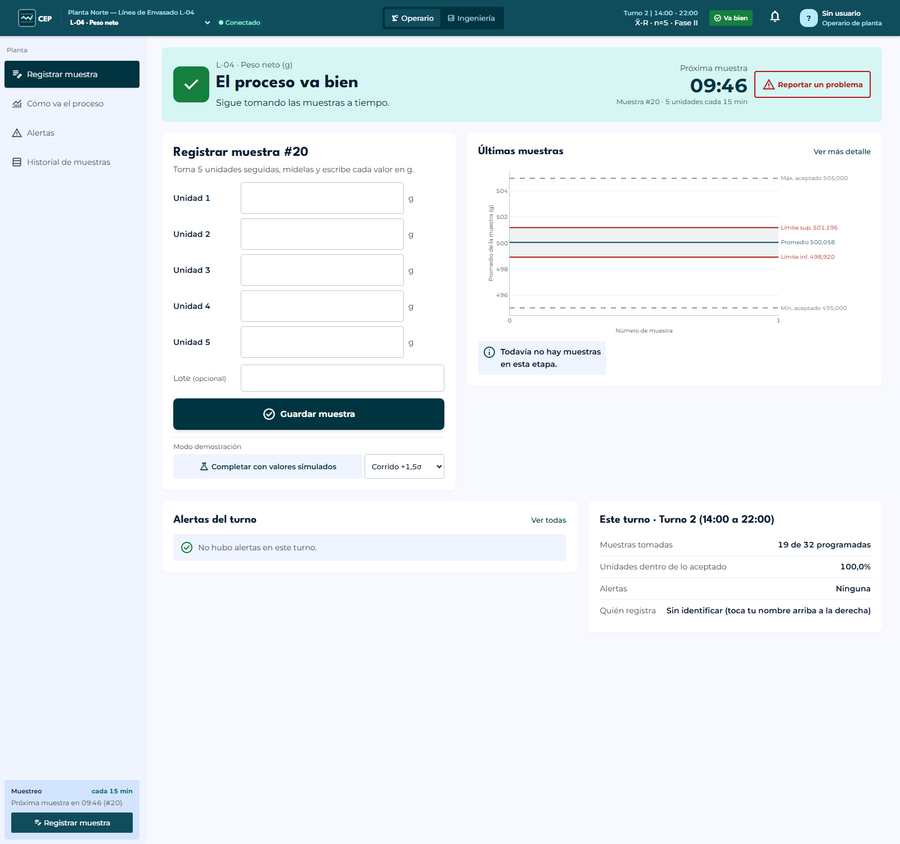

La vista Operario está pensada para personas no expertas: todo se explica en palabras y el menú
lateral nunca lleva a pantallas de Ingeniería. Tiene cuatro pantallas: **Registrar muestra**,
**Cómo va el proceso**, **Alertas** e **Historial de muestras**.

### 3.1 Registrar una muestra
1. Arriba se ve el **estado del proceso** (por ejemplo «El proceso va bien»), **qué hacer** y la
   cuenta regresiva hasta la **próxima muestra**.
2. Escribir el valor de cada unidad (o, en conteos, cuántas unidades se revisaron y cuántas salieron
   defectuosas / cuántas fallas hubo). `Enter` pasa al campo siguiente; se acepta coma decimal.
3. Mientras se escribe, la app dice el promedio de la muestra y si está dentro de lo normal.
4. (Opcional) Escribir el lote y pulsar **Guardar muestra**.
5. Si un valor está muy lejos de lo habitual (por ejemplo 5000 en lugar de 500,0), la app pregunta
   si está bien escrito antes de guardar.
6. **Deshacer:** durante 10 minutos se puede anular la última muestra (por ejemplo, por un error de
   digitación). No se borra: queda como «Anulada» en el historial con el motivo, y sus valores
   vuelven al formulario para corregirlos.

> Modo demostración (se activa en Ingeniería · Límites y reglas): botón **Completar con valores
> simulados** para mostrar la app sin datos reales.

### 3.2 Atender una alerta
1. Cada alerta explica en palabras qué pasó (por ejemplo «Los últimos 9 valores quedaron todos por
   encima del promedio: el proceso parece haberse corrido»).
2. Pulsar **Anotar qué pasó**, escribir la causa (si se conoce) y lo que se hizo, y elegir el estado.
3. Para **Resuelta** son obligatorias ambas. Queda registrado el usuario y la hora.

### 3.3 Reportar un problema
Botón **Reportar un problema**: se elige si se detuvo el proceso, si se retuvo un lote o si se vio
algo raro. Crea una alerta manual.

### 3.4 Cómo va el proceso
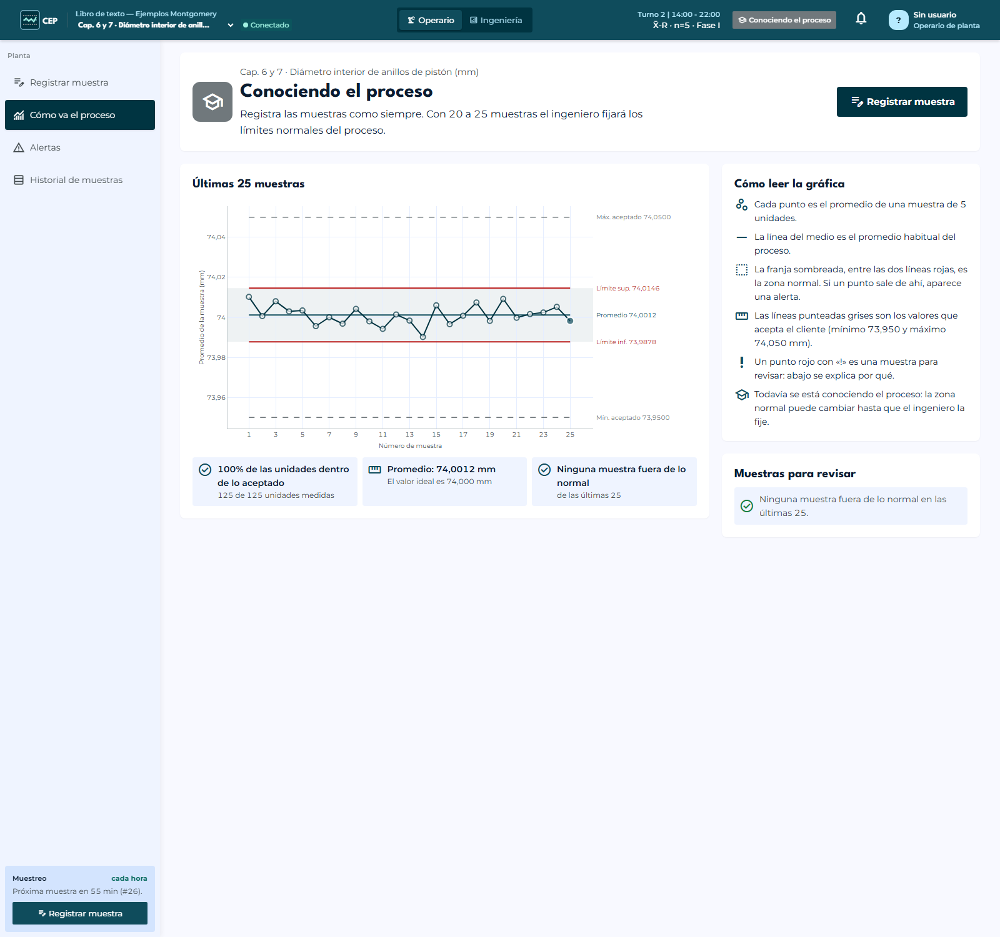

Gráfica grande de las últimas 25 muestras con una guía para leerla (franja normal, valores
aceptados por el cliente), resumen en palabras (% de unidades dentro de lo aceptado, promedio) y la
lista de **muestras para revisar** con su explicación.

### 3.5 Alertas e historial
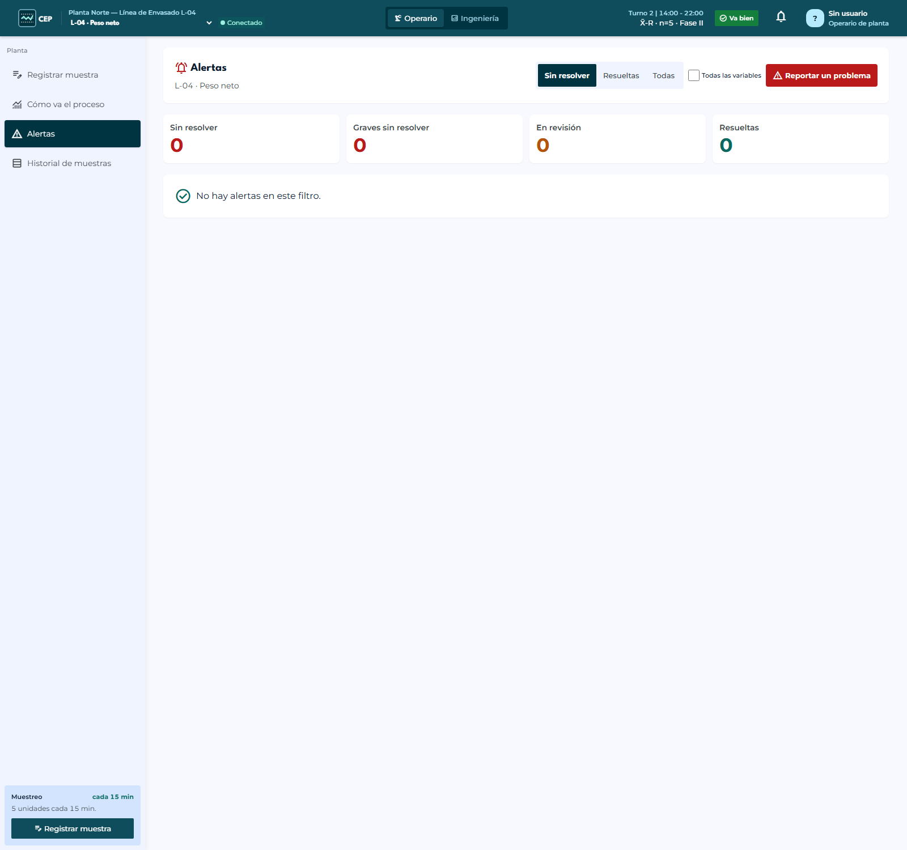
- **Alertas:** filtros sin resolver / resueltas / todas.
- **Historial de muestras:** todas las muestras (incluidas las archivadas y anuladas), exportable a CSV.

✍ Completar: captura del equipo registrando un subgrupo propio.

---

## 4. Ingeniería · Plantilla de carga (recomendada)

La forma más segura de cargar datos: una planilla Excel generada por la aplicación a la medida del
proceso, que se llena y se vuelve a subir.

1. **Arma la plantilla:** elige el proceso (o crea uno nuevo), marca las variables y escribe cuántas
   muestras incluir en cada bloque: **«Para establecer los límites»** (Fase I; se recomiendan 20 a
   25) y **«Monitoreo»** (Fase II). Con «Agregar variable nueva» se definen variables que todavía
   no existen (nombre, cómo se registra, unidades por muestra, frecuencia y valores aceptados).
   Elige las columnas adicionales (lote, operario, observaciones) y la fecha de la primera muestra.
2. **Descargar plantilla:** el Excel trae una hoja de instrucciones y una hoja por variable, con las
   muestras ya numeradas, la fecha y hora sugeridas, y:
   - solo se puede escribir en las celdas de datos (lo demás está protegido, sin contraseña);
   - acepta solo números (coma decimal) y conteos enteros; las defectuosas no pueden superar las
     revisadas;
   - los valores fuera de lo aceptado se pintan de ámbar;
   - calcula sola el promedio y el rango (o el % de defectuosas);
   - viene lista para imprimir (horizontal, encabezado en cada página) por si se llena a mano.
3. **Subir la plantilla llenada:** la aplicación muestra un **informe de revisión** antes de guardar:
   cuántas muestras se cargarán, cuáles tienen errores (con hoja y número de muestra) y avisos
   (valores fuera de lo aceptado o sospechosos). Nada se guarda hasta pulsar **Cargar**.
4. La misma plantilla se puede subir varias veces a medida que se llena: las filas vacías se
   ignoran y las muestras ya cargadas no se duplican. Cada muestra entra en su fase: las de
   monitoreo se cargan cuando la variable ya tiene límites fijados.
5. Las variables (y el proceso) nuevas se crean al cargar. Todo queda en el historial de cambios con
   el nombre del archivo y su huella SHA-256.

> Los avisos no bloquean la carga: un valor «muy lejos de lo habitual» se carga si el resto de la
> muestra es válido. Revisa el informe antes de pulsar **Cargar**; si fue un error de escritura,
> corrígelo en el Excel y vuelve a subirlo antes de cargar.

---

## 4b. Ingeniería · 1. Datos y carga CSV
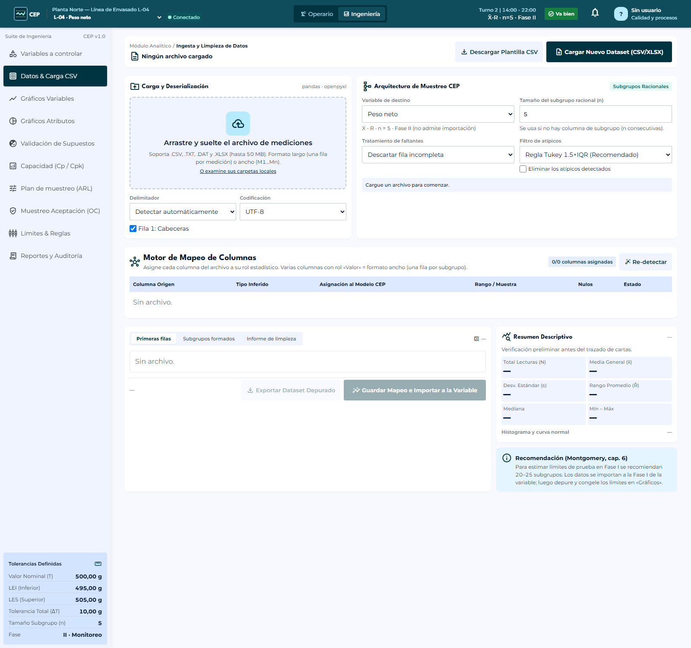

1. **Cargar Nuevo Dataset** o arrastrar un `.csv` / `.xlsx` (plantilla disponible en la misma pantalla).
2. Revisar delimitador, codificación y cabecera (se detectan automáticamente).
3. **Mapeo de columnas:** asignar el rol de cada columna (fecha, subgrupo, valor, operario, lote…).
   Formato ancho: asignar el rol *Valor* a todas las columnas M1…Mn.
4. Elegir *n* (si no hay columna de subgrupo), tratamiento de faltantes y filtro de atípicos.
5. Revisar las pestañas **Primeras filas / Subgrupos formados / Informe de limpieza** y el resumen
   descriptivo con histograma.
6. **Guardar mapeo e importar** a la variable de destino (se agrega a su Fase I).

✍ Completar: descripción del dataset propio del equipo.

---

## 5. Ingeniería · 2. Gráficos por variables
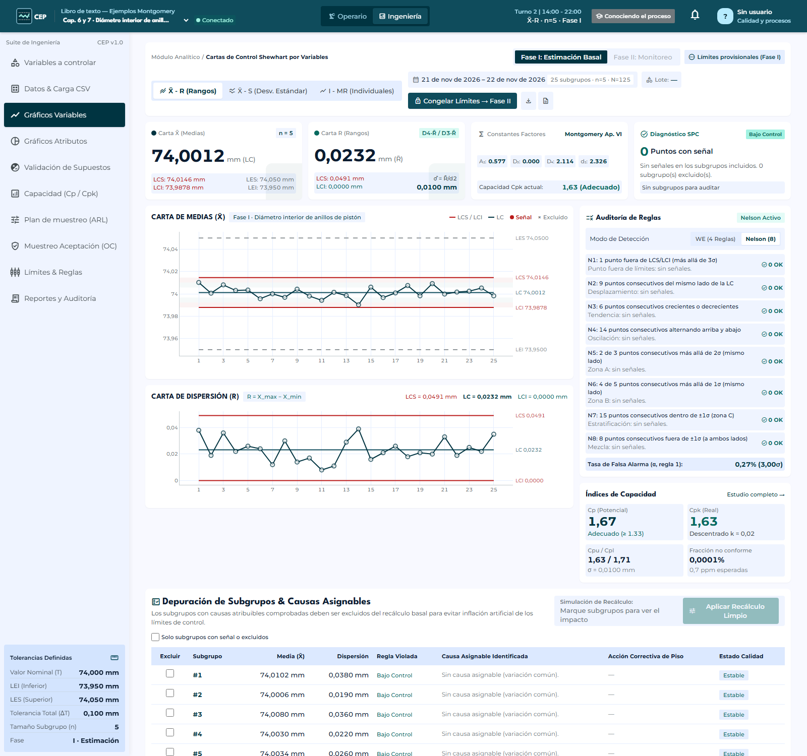

### 5.1 Lectura de la pantalla
Tarjetas de límites (X̄ y dispersión), constantes de la tabla (A₂, D₃, D₄, d₂…), diagnóstico,
cartas con zonas ±1σ/±2σ, auditoría de reglas e índices de capacidad.

### 5.2 Fase I: depurar y recalcular
1. Activar **Solo subgrupos con señal** para ver los candidatos.
2. Marcar **Excluir** en los subgrupos con causa asignable. La **simulación de recálculo** muestra
   Δ LCS, Δ LC, Cpk antes → después y las señales que quedarían.
3. **Aplicar recálculo limpio:** se pide la causa (obligatoria) y la acción de cada subgrupo.
4. Repetir hasta que no queden señales injustificadas.
5. **Congelar límites → Fase II.** Se advierte si quedan señales o si hay menos de 20 subgrupos.

### 5.3 Fase II y vuelta a Fase I
- En Fase II la carta usa los límites congelados; las señales se gestionan como alarmas.
- **Volver a Fase I** (con motivo obligatorio) archiva los límites; opcionalmente usa los datos de
  la Fase II como nueva base.

### 5.4 Tipo de carta y reglas
X̄-R, X̄-S o I-MR (solo en Fase I) y preset de reglas WE (4) o Nelson (8), con justificación.

✍ Completar: interpretación de las cartas del proceso del equipo.

---

## 6. Ingeniería · 3. Gráficos por atributos
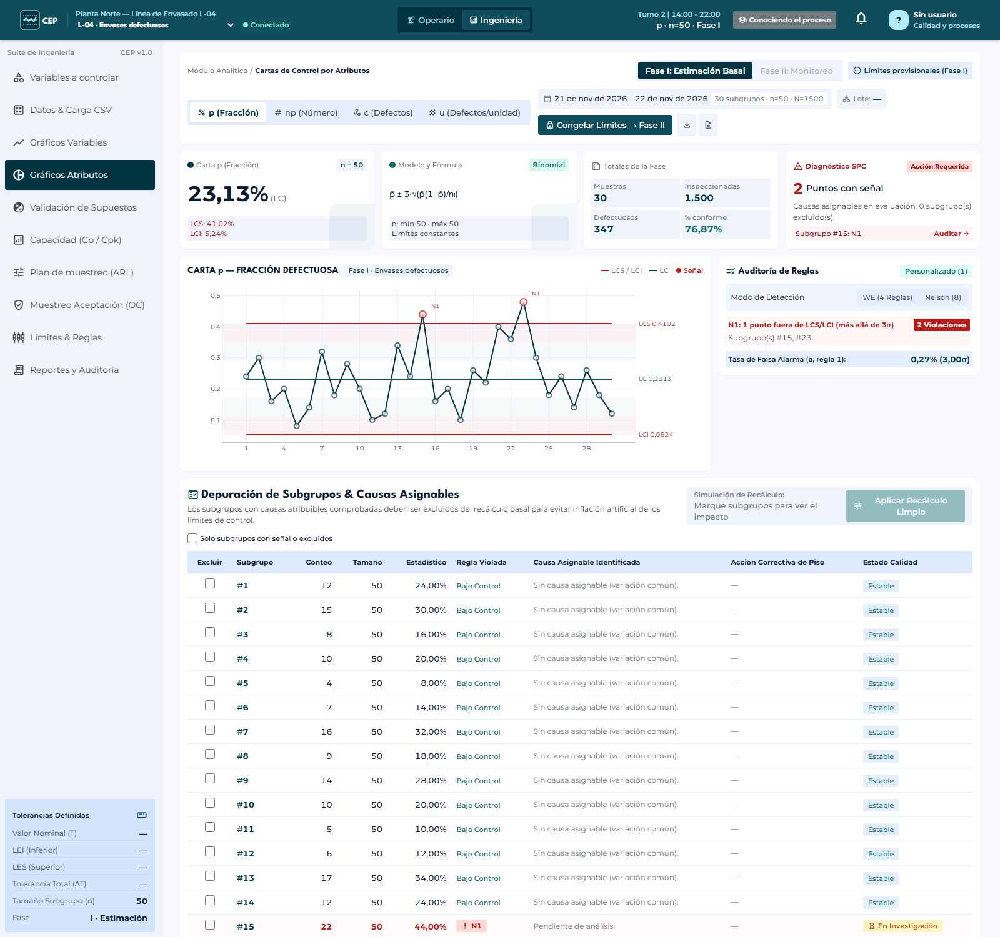

- Cartas p, np, c, u; p y u con **límites variables** si el tamaño de muestra cambia.
- Misma depuración de Fase I que en variables.
- **Asistente:** ¿defectuosos o defectos?, ¿tamaño constante?, ¿proporción o conteo? → carta recomendada.

✍ Completar: ejemplo de uso del asistente.

---

## 7. Ingeniería · 4. Validación de supuestos
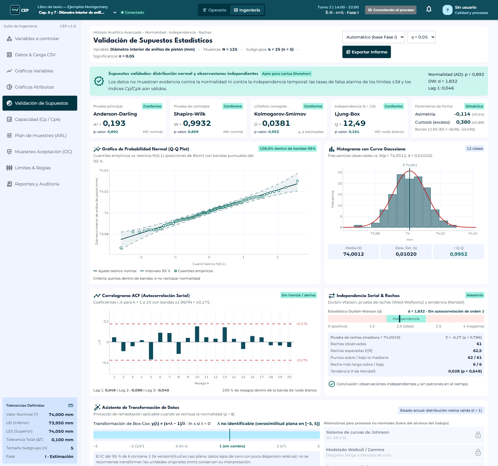

| Supuesto | Pruebas | Criterio |
|---|---|---|
| Normalidad | Shapiro-Wilk, Anderson-Darling, Lilliefors, asimetría/curtosis, Q-Q | p ≥ α ⇒ no se rechaza |
| Independencia | ACF con bandas ±1.96/√N, Ljung-Box, Durbin-Watson | p ≥ α; 1.5 ≤ d ≤ 2.5 |
| Patrones | Rachas sobre la mediana, τ de Kendall | p ≥ α |
| Transformación | Box-Cox (λ̂ e IC 95 %) | Si el IC contiene 1, no transformar |

Selectores: datos analizados (base Fase I / Fase II) y nivel de significancia α.

✍ Completar: conclusión sobre los supuestos del proceso del equipo.

---

## 8. Ingeniería · 5. Capacidad del proceso
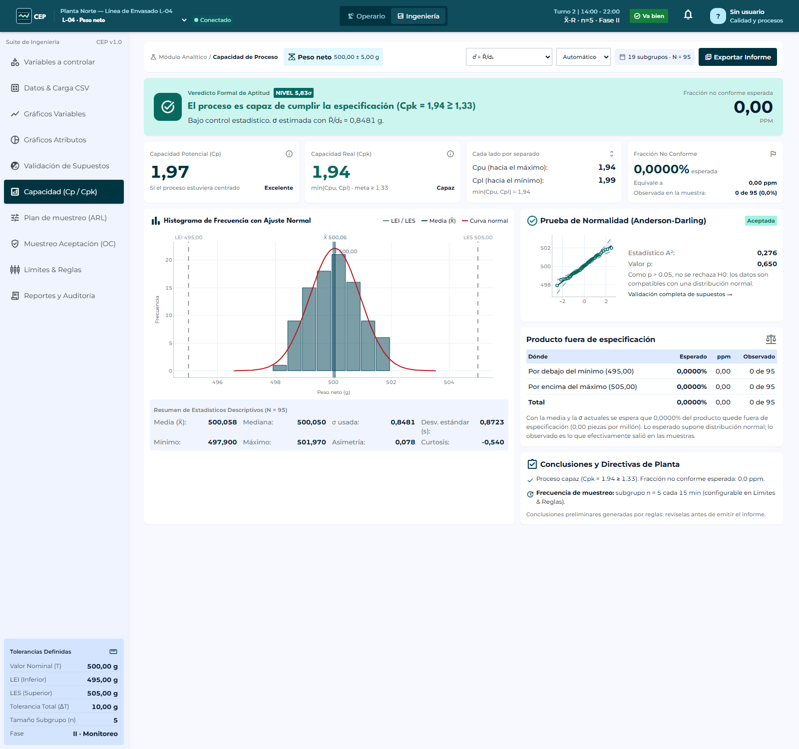

- Índices **Cp, Cpk, Cpu y Cpl** con la σ de la carta (R̄/d₂, s̄/c₄ o MR̄/d₂) o con la σ fijada
  por el ingeniero en el plan de muestreo.
- Fracción no conforme esperada (en % y ppm) y observada, separada en "por debajo del mínimo" y
  "por encima del máximo"; veredicto (≥ 1.33 capaz, 1–1.33 marginal, < 1 no capaz).
- Advertencia si el proceso no está bajo control (los índices no serían confiables).

✍ Completar: análisis de capacidad del proceso del equipo.

---

## 9. Ingeniería · 6. Plan de muestreo (ARL / ATS)
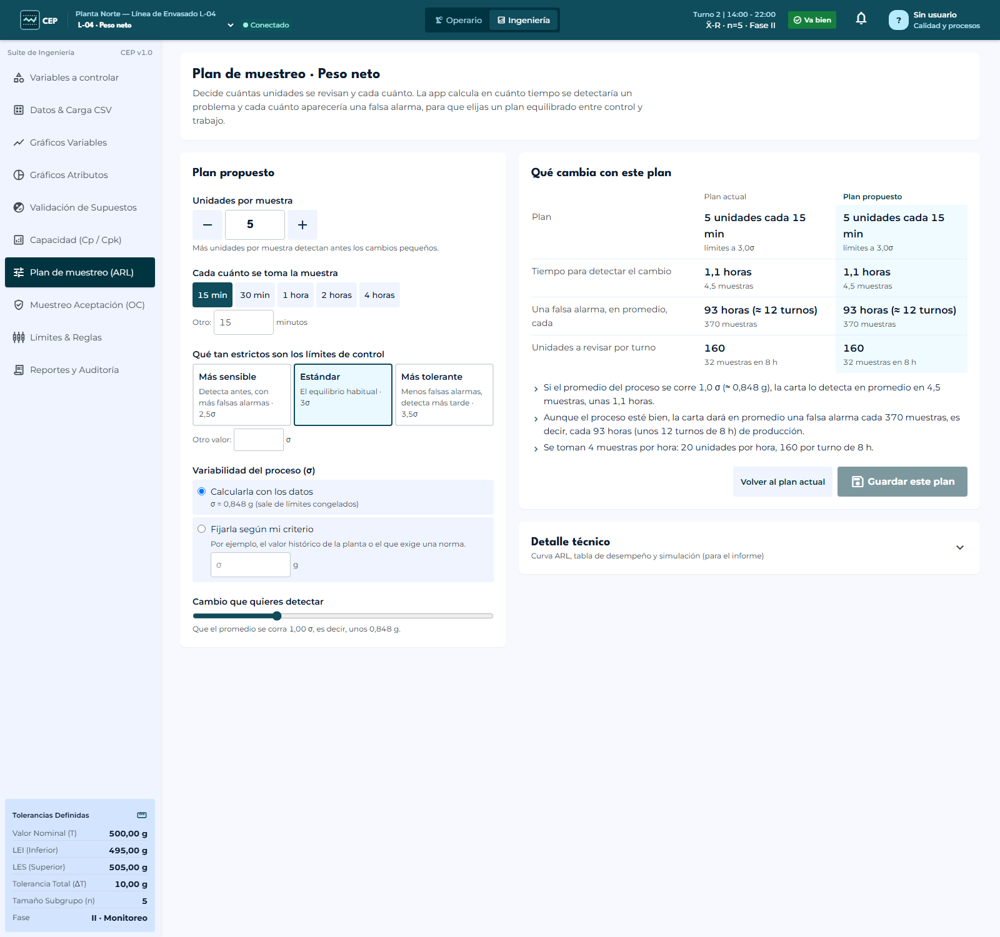

1. Ajustar **unidades por muestra** (n), **cada cuánto** se toma, **qué tan estrictos son los
   límites** (más sensible 2,5σ, estándar 3σ, más tolerante 3,5σ u otro valor) y la
   **variabilidad del proceso (σ)**: calculada con los datos o **fijada según el criterio del
   ingeniero** (historial de la planta, norma).
2. Elegir el **cambio que se quiere detectar** (en σ, con su equivalente en la unidad de medida; en
   atributos, el nivel habitual de defectos y el nivel a detectar).
3. Comparar **plan actual vs. propuesto**: tiempo para detectar el cambio (ATS₁ y ARL₁), cada
   cuánto aparece una falsa alarma (ATS₀ y ARL₀) y unidades a revisar por turno (carga muestral).
4. **Guardar este plan** (pide el motivo; queda en el historial). En Fase II los límites se
   recalculan con el centro y la σ congelados; si cambia n, las muestras de monitoreo tomadas con el
   n anterior pasan al archivo.
5. **Detalle técnico:** curva ARL vs δ, tabla de desempeño y simulación de Monte Carlo (cartas X̄/I);
   en atributos, tabla con ARL exacto (Binomial / Poisson).

### 9.1 Variables a controlar
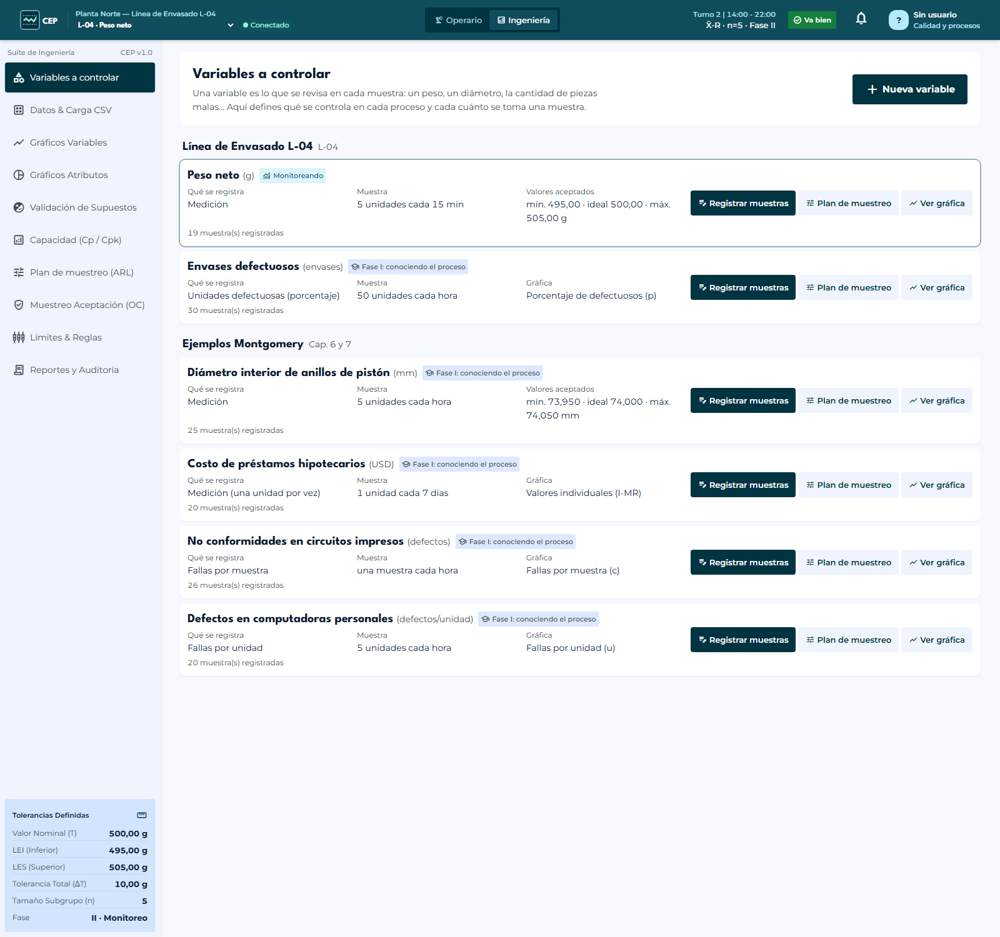

Pantalla **Variables a controlar** (o «+ Nueva variable…» en el selector del encabezado): un
asistente de 4 pasos pide el proceso, el nombre, cómo se registra cada unidad (la mido / la
clasifico buena o mala / cuento sus fallas), el tamaño de muestra y la frecuencia, y **recomienda
la carta explicando por qué**. Las variables sin muestras se pueden eliminar.

✍ Completar: justificación del diseño elegido (n y h).

---

## 10. Ingeniería · 7. Muestreo de aceptación
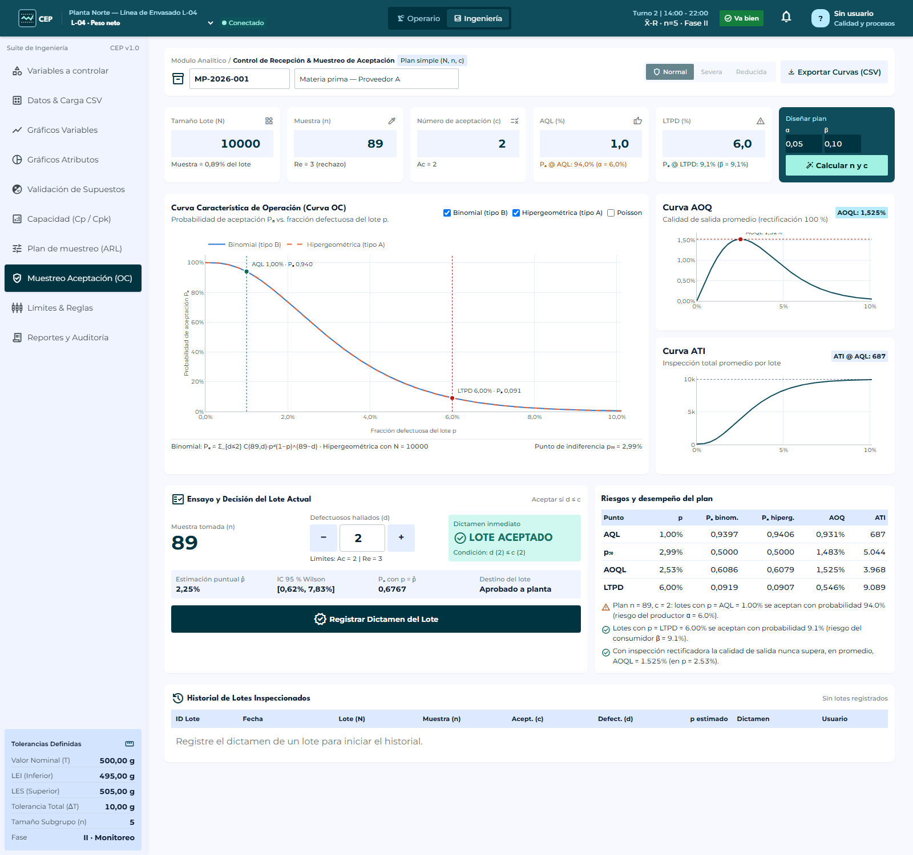

1. Ingresar N, n, c, AQL y LTPD (o **Calcular n y c** a partir de AQL, LTPD, α y β).
2. Curva OC (binomial, hipergeométrica, Poisson), AOQ con AOQL y ATI.
3. **Ensayo del lote actual:** ingresar los defectuosos d → dictamen (d ≤ c), p̂ e IC de Wilson.
4. **Registrar dictamen** para el historial de lotes.

✍ Completar: plan propuesto por el equipo y su justificación.

---

## 11. Ingeniería · Límites, reglas y auditoría
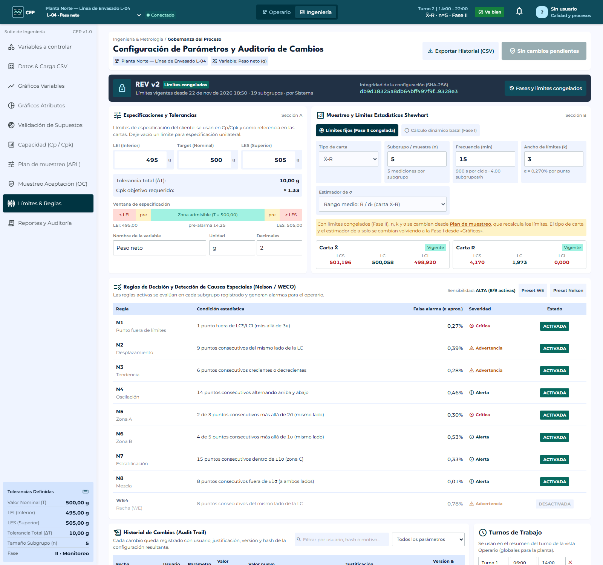

- Especificaciones (LEI, objetivo, LES), muestreo (n, frecuencia, k, estimador σ, tipo de carta).
- Reglas activables una a una o por preset.
- **Guardar nueva revisión:** pide justificación; sube la versión y registra un SHA-256 de la configuración.
- **Historial de cambios** con filtros y exportación CSV; **turnos** de trabajo; **modo
  demostración** (botón de valores simulados en la vista Operario).
- Con límites congelados, n, k y σ se cambian desde el **Plan de muestreo** (recalcula los
  límites); el estimador y el tipo de carta solo en Fase I.

---

## 11b. Ingeniería · Base de datos y respaldos

Todos los procesos se guardan en un único archivo (`Documentos\CEP\cep.db` en el programa de
escritorio). En esta pantalla:

- **Tus datos:** cuántos procesos, variables y muestras hay, dónde está la base y su tamaño.
- **Respaldar ahora:** guarda una copia en `respaldos\`. Además, el programa hace un respaldo cada
  vez que se abre (se conservan los últimos 20).
- **Volver a este:** devuelve la base al estado de un respaldo. Antes guarda un respaldo de la base
  actual, así que siempre se puede deshacer.
- **Descargar una copia / Restaurar desde un archivo:** para guardar los datos aparte o pasarlos a
  otro equipo.
- **Cargar demostración:** solo con la base vacía; carga un proceso de envasado y los ejemplos del
  libro de Montgomery.

---

## 12. Ingeniería · 8. Reportes

1. Elegir la plantilla: integral, capacidad y supuestos, control en proceso o trazabilidad.
2. Ajustar los módulos a incluir.
3. **Generar y previsualizar** (primera página).
4. **Exportar PDF** o **Exportar Excel**. El archivo se descarga y queda en el historial con su SHA-256.
5. **Verificar** (ícono ✔): recalcula el hash y confirma que el archivo no fue modificado.

El **PDF se compila con LaTeX** (fuente predeterminada de LaTeX) y está pensado para lectores que no
son del área: estado general en una frase, «En pocas palabras», indicadores con su significado,
gráfica de control con guía de lectura, cumplimiento de la especificación, verificación de los
datos, plan de muestreo, alertas, lotes, historial de cambios, anexo técnico y glosario. **Solo
describe** los datos: no incluye recomendaciones. Si el equipo no tiene LaTeX, se genera el PDF con
el formato de respaldo (reportlab) y la pantalla lo avisa (ver `docs/INSTALACION.md`).

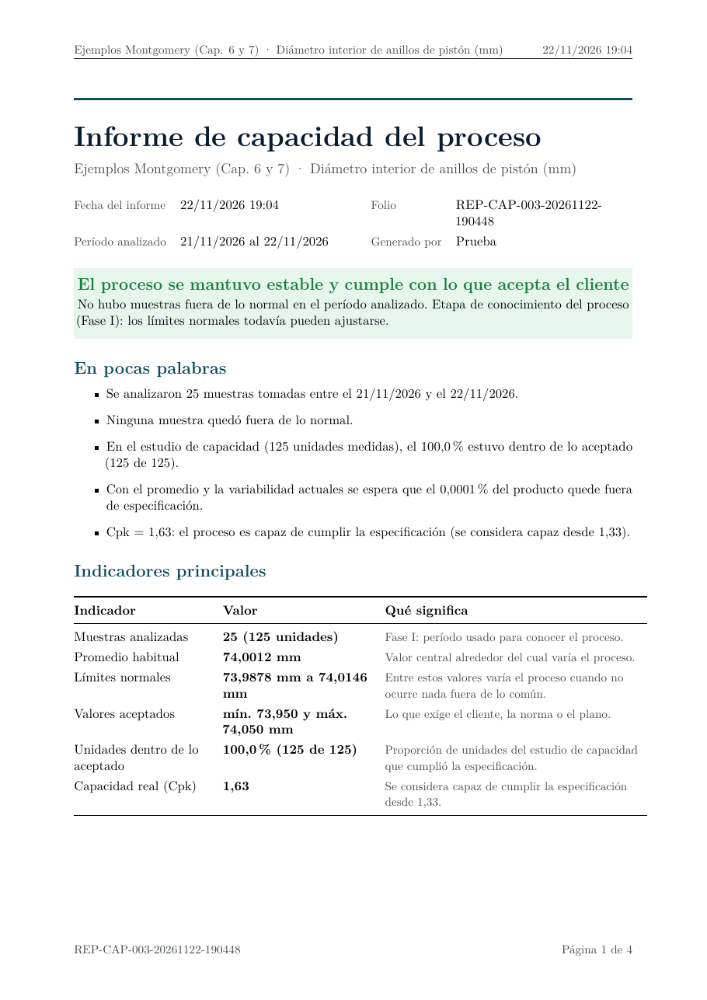

---

## 13. Caso práctico completo

Proceso simulado: envasado de 500 g, σ = 1 g, especificación 495–505 g, subgrupos de n = 5 cada
15 min; corrimiento de +1.5σ desde el subgrupo 20.

1. **Fase I:** base con los subgrupos 1–19 (ya cargada y congelada en los datos de demostración).
   ✍ Completar: límites obtenidos.
2. **Fase II:** registrar en la vista Operario los subgrupos 20–25 de `datos_prueba/proceso_simulado.csv`.
   Resultado esperado: N1 en los subgrupos 20, 22 y 24; N5 desde el 22; N6 desde el 24.
3. **Atender alarmas:** registrar causa ("cambio de lote de envase") y acción.
4. **Capacidad:** comparar el Cpk de la base con el de la ventana que incluye el corrimiento.
5. **Diseño:** con n = 5, k = 3 y δ = 1.5 → ARL₁ ≈ 1.57 muestras (≈ 24 min con h = 15 min).
6. **Reporte integral** en PDF.

✍ Completar: discusión de resultados y conclusiones del equipo.

---

## Anexo A — Fórmulas

| Tema | Fórmula |
|---|---|
| X̄-R | LC = X̿; LCS/LCI = X̿ ± A₂R̄; carta R: [D₃R̄, D₄R̄]; σ̂ = R̄/d₂ |
| X̄-S | X̿ ± A₃s̄; carta S: [B₃s̄, B₄s̄]; σ̂ = s̄/c₄ |
| I-MR | x̄ ± 3·MR̄/1.128; carta MR: [0, 3.267·MR̄] |
| p | p̄ ± 3√(p̄(1−p̄)/nᵢ) |
| np | np̄ ± 3√(np̄(1−p̄)) |
| c | c̄ ± 3√c̄ |
| u | ū ± 3√(ū/nᵢ) |
| Capacidad | Cp = (LES−LEI)/6σ; Cpk = mín[(LES−μ)/3σ, (μ−LEI)/3σ] |
| ARL | β = Φ(k−δ√n) − Φ(−k−δ√n); ARL₁ = 1/(1−β); ARL₀ = 1/α; ATS = ARL·h |
| Muestreo | Pa = Σ_{d≤c} C(n,d)pᵈ(1−p)ⁿ⁻ᵈ; AOQ = Pa·p(N−n)/N; ATI = n + (1−Pa)(N−n) |

Detalle completo en los docstrings de `app/core/`.

## Anexo B — Validación contra Montgomery

| Ejemplo (Montgomery) | Valor del libro | Valor de la app |
|---|---|---|
| Anillos de pistón X̄-R | X̿ = 74.001, LCS = 74.014, LCI = 73.988, LCS_R = 0.049 | 74.0012 / 74.0146 / 73.9878 / 0.0491 |
| Anillos X̄-S | s̄ = 0.0094, LCS_S = 0.0196 | 0.0094 / 0.0196 |
| Anillos Cp (74 ± 0.05) | 1.68 (σ̂ = 0.0099 redondeado) | 1.67 (σ̂ sin redondear) |
| Préstamos I-MR | x̄ = 300.5, MR̄ = 7.79, LCS = 321.22 | 300.5 / 7.79 / 321.22 |
| Jugo, carta p | p̄ = 0.2313, LCS = 0.4102; revisado 0.2150 / 0.3893 | Idénticos |
| Circuitos, carta c | c̄ = 19.85, LCS = 33.22 | 19.85 / 33.21 (el libro redondea c̄) |
| Computadoras, carta u | ū = 1.93, LCS = 3.79 | 1.93 / 3.79 |
| ARL (n = 4, δ = 1.5) | β = 0.50, ARL₁ = 2 | 0.50 / 2.00 |
| Plan n = 89, c = 2 | Pa(0.01) = 0.9397, ATI = 687 | 0.9397 / 687 |

Pruebas automáticas: `tests/` (ejecutar `pytest`).

## Anexo C — Glosario
CEP, LC, LCS, LCI, LES, LEI, subgrupo racional, causa común / asignable, Fase I / II, ARL, ATS,
AQL, LTPD, AOQ, AOQL, ATI, Cp, Cpk, Cpu, Cpl, fracción no conforme. ✍ Completar definiciones.
